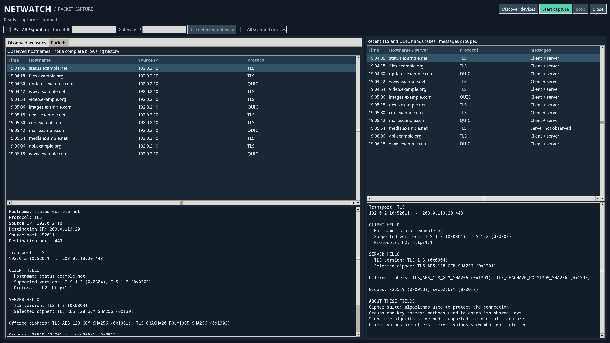

# netwatch

netwatch is a Linux command-line project for exploring local network traffic in C. It can discover IPv4 devices with ARP, capture packets on a network interface, and show hostnames found in TLS and QUIC connection handshakes. It can also use ARP spoofing to route selected devices' traffic through the computer running netwatch. It does not change the router's configuration.

Use spoofing only on networks and devices you own or are authorized to inspect. It can briefly disrupt connectivity.



*The dashboard with example data; no real traffic is shown.*

## Build

You need Linux, `gcc`, `make`, and the OpenSSL development headers and library (`libcrypto`). Raw packet sockets and changes to IPv4 forwarding require root privileges. The port restriction also needs `nft` and permission to manage firewall rules.

Netwatch automatically selects the first active default IPv4 route. Build it with:

```sh
make
```

To launch the desktop app, also install Python 3, Tkinter and `pkexec`, then run:

```sh
make app
```

On Fedora, the Tkinter package is `python3-tkinter`. Click **Start capture**
and authorize the request. The app runs as your normal user; a privileged helper
starts only the existing capture program. **Stop** ends the capture. By default
it captures traffic on your computer. To use IPv4 ARP spoofing, enable the
option, enter the target and gateway IPv4 addresses, and start capture. The app
can fill in the detected default gateway, or use the latest device scan to target
all responding clients (excluding this computer and the gateway). Discovering
devices starts the scan immediately. The all-devices option requires a new scan
if the interface, local address, or default gateway changes, and supports up to
64 clients. Use spoofing
only on devices and networks you are authorized to inspect. Stop capture and
wait for cleanup to finish before starting another session. The app's capture files
are temporary and do not overwrite CLI logs. Use the CLI separately if you
want to keep its logs.

**Discover devices** runs the existing IPv4 ARP scan after authorization and
lists devices that reply. Run it only on a network you are authorized to scan;
devices that do not respond will not appear.

The dashboard shows observed TLS and QUIC hostnames alongside grouped TLS and QUIC
handshakes; the packet list is available in a separate tab. These are hostname
observations, not a complete browsing history or confirmed page visits. Select
a hostname to inspect its connection and available handshake details. Select
a packet to see its Ethernet addresses, available protocol details, and first
96 frame bytes. ARP requests and replies are included. Select a handshake to
see its ClientHello and ServerHello details. The app displays the most recent
1,000 packets; the packet data is collected in a temporary JSONL file during
capture.
The app opens full screen; press Escape to leave full screen or F11 to toggle it.
Capture, scan, and gateway errors are shown in a dialog with details.

Run the automated tests with `make test`. They require no root privileges or
network access. The port-lock integration test requires a separate network
namespace and is not included; `test_hd.c` and `test_keys.c` are standalone
QUIC experiments rather than automated tests.

## Usage

```sh
sudo ./netwatch
sudo ./netwatch --restrict-port 45000
sudo ./netwatch --scan
sudo ./netwatch --spoof 192.0.2.10 192.0.2.1
sudo ./netwatch --spoof 192.0.2.10 192.0.2.1 192.0.2.20
sudo ./netwatch --all
```

The `192.0.2.x` addresses are reserved for documentation. Replace them with the actual target and gateway addresses on your local network before running the spoofing examples.

| Mode | Behavior |
| --- | --- |
| No flag | Capture packets visible to this computer. |
| `--restrict-port PORT` | Capture and log TCP traffic using this local port while temporarily rejecting other new connections. Cannot be combined with scan or spoof modes. |
| `--scan` | Send ARP requests across the local IPv4 subnet, print devices that reply, then exit. |
| `--spoof TARGET GATEWAY [MORE_TARGETS...]` | Route traffic between the named targets and gateway through this computer while capturing it. The gateway is always the second address. |
| `--all` or `-all` | Scan once, print all discovered IPs and the selected targets, then spoof up to 64 discovered clients. Your computer and the gateway are excluded. |
| `--packet-json` | Also write captured packet details to `netwatch_packets.jsonl`. Can be combined with ordinary capture or `--spoof`. |

The spoofing modes cannot be combined with `--scan`, and only one netwatch spoofing process can run at a time. Press **Ctrl+C** to stop. The program then sends the real ARP mappings to the targets and gateway and restores this computer's original IPv4 forwarding setting if it changed it.

`--restrict-port` uses the **local source port** of outgoing TCP connections. To isolate one HTTPS test, start `sudo ./netwatch --restrict-port 45000`, then run `curl -q -4 --http1.1 --noproxy '*' --local-port 45000 https://example.com/`. Replies use local destination port 45000. Other new connections are rejected; existing connections, loopback, DNS on port 53, and essential IPv6 control traffic remain available. New inbound connections are rejected. The restriction applies to this computer's IPv4 and IPv6 traffic, not traffic forwarded for other devices. The log contains only TCP packets using the chosen local port. Temporary rules are removed on normal exit, Ctrl+C, or an unexpected capture-process exit. Existing firewall rules still apply.

If both netwatch and its watcher are forcibly killed, remove the leftover restriction with `sudo nft delete table inet netwatch_port_lock`.

During capture, netwatch prints a table roughly every ten seconds with `COUNT`, `WEBSITE`, `VISITOR IP`, and `LAST SEEN`. The visitor IP is the source IP of the packet containing the hostname. Rows are grouped by hostname and source IP; counts are hostname observations, including background app traffic, rather than confirmed page visits. The heading number is the number of distinct rows, and counts accumulate until the program exits.

Packet details and short hex/ASCII payload dumps go to `netwatch.log` in the current directory. TLS and QUIC handshake events go to `netwatch_tls.jsonl`; with `--packet-json`, packet events also go to `netwatch_packets.jsonl`. Each capture run **overwrites** the files it writes. They may contain sensitive traffic information, so handle them accordingly. `--scan` only prints scan results and does not create these files.

## How it works

1. **Discovery:** ARP asks which device owns each usable IPv4 address on the local subnet. Replies supply IP and MAC address pairs. A device that does not reply during the scan will not appear.
2. **Spoofing:** For each target, netwatch tells the target that the gateway IP is at this computer's MAC address and tells the gateway that the target IP is at this computer's MAC address. Linux IPv4 forwarding passes the intercepted packets onward. The program repeats these ARP replies about every two seconds.
3. **Capture:** A Linux `AF_PACKET` raw socket receives Ethernet frames on the chosen interface. The parser reads IPv4 and IPv6 headers and TCP or UDP headers. IPv6 extension headers are inspected where supported; fragmented IPv6 packets are skipped.
4. **Handshakes:** For TCP, it parses TLS ClientHello and ServerHello messages, including the ClientHello Server Name Indication (SNI). For UDP port 443, it derives QUIC version 1 Initial keys and decrypts Initial packets to inspect the TLS hello messages carried inside them. OpenSSL's `libcrypto` supplies the cryptographic functions.
5. **Statistics:** It records each hostname with the packet's source IP address, updates its count and last-seen time, and prints the table periodically.

The main implementation is in `src/main.c`.

## Limits

- IPv6 capture covers packets visible on the selected interface. Discovery and spoofing use ARP and remain IPv4-only.

- A scan finds responding devices on the local IPv4 subnet, not necessarily every device connected to Wi-Fi. `--all` uses only the results of its startup scan; it does not add devices later.
- The hostname table is incomplete by design. It does not reveal URLs or encrypted page contents. Out-of-order TLS segments, unsupported QUIC versions, encrypted ClientHello, VPNs, and fragmented IPv6 traffic may not produce a hostname. QUIC assembly tracks up to 64 connections, replacing the least recently used when needed. A server hello is shown only when its packets are captured and successfully parsed.
- Handshake details show names for common TLS versions, cipher suites, groups, and signature algorithms. Unknown values remain visible as hexadecimal codes.
- A crash or forced termination can skip ARP and forwarding cleanup. Normal cleanup runs when you press Ctrl+C.
